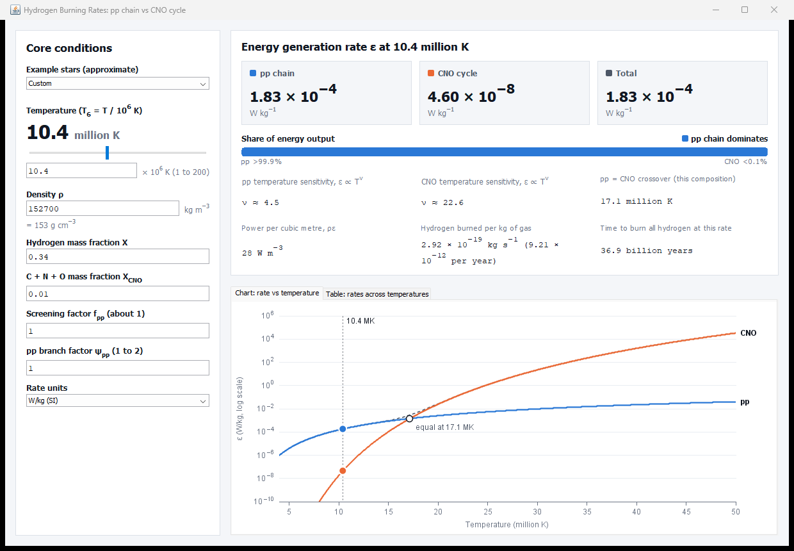

# Hydrogen Burning Rates

A Java program that calculates how much energy a star's core releases by fusing hydrogen into helium.
It does this for both hydrogen-burning routes:

- the **proton–proton (pp) chain**, which powers the Sun and smaller stars
- the **CNO cycle**, which takes over in stars that are hotter and more massive than the Sun

You set the core temperature, density and composition. The program shows each route's energy generation rate ε, which one dominates, and how the rates change with temperature.



## Requirements

| To... | You need |
|---|---|
| Build it | A **JDK** (Java Development Kit), version 8 or newer, so that `javac` and `jar` are available. A Java *runtime* alone (JRE) can run the program but cannot build it. |
| Run it | Java 8 or newer (a JRE is enough). |

There are no other libraries. The window uses Swing, which is part of standard Java.

If you don't have a JDK, install one such as Eclipse Temurin from <https://adoptium.net>. On Windows you can use winget:

```
winget install EclipseAdoptium.Temurin.21.JDK
```

Open a **new** terminal after installing so `javac` is on the PATH. Check it with `javac -version`.

## Build

On Windows, from `SunRates/java`:

```
build.bat
```

On any system (macOS, Linux or Windows), from `SunRates/java`:

```
javac --release 8 -encoding UTF-8 -d out src/*.java
jar cfe FusionRates.jar FusionRatesApp -C out .
```

`--release 8` produces a jar that runs on Java 8 and every later version. Drop it if you only use a newer Java.

If the build fails with "The process cannot access the file", the calculator window is still open and has `FusionRates.jar` locked. Close the window and build again.

## Run

| Command | What it does |
|---|---|
| `java -jar FusionRates.jar` | Opens the desktop window |
| `java -jar FusionRates.jar --cli` | Starts the interactive console version |
| `java -jar FusionRates.jar --cli 10 15.7 20 30` | Prints a table for the listed temperatures (in million K) and exits |

### The desktop window

- **Example stars**: fills in typical core values for the Sun, a red dwarf, an F star, a B star and a metal-poor star. The values are approximate.
- **Temperature**: drag the slider (1 to 200 million K, on a log scale) or type an exact value and press Enter.
- **Density, X, X_CNO**: type new values. Results update as you type. If a value is invalid, the panel says what to fix and hides the results until you do.
- **Correction factors and units**: f_pp, ψ_pp, and a switch between W/kg and erg g⁻¹ s⁻¹.
- **Chart tab**: both rates against temperature on a log scale. Hover to read values; click to set the temperature. A circle marks the temperature where pp and CNO are equal.
- **Table tab**: rates over a temperature range and step that you choose.

### The console version

Start with `--cli`. It begins with the Sun's core values. Type commands at the `T (MK) >` prompt:

| Command | Effect |
|---|---|
| `15.7` | Full rate breakdown at 15.7 million K |
| `table 5 40 2.5` | Table from 5 to 40 million K in steps of 2.5 |
| `rho 1.527e5` | Set density in kg m⁻³ |
| `x 0.34` | Set the hydrogen mass fraction |
| `xcno 0.01` | Set the carbon + nitrogen + oxygen mass fraction |
| `fpp 1`, `psi 1` | Set the correction factors |
| `sun` | Reset to the Sun's core values |
| `show` | Print the current settings |
| `help`, `quit` | Show the commands, or exit |

Example output for the Sun's core composition:

```
   T (MK)     pp (W/kg)    CNO (W/kg)  total (W/kg)      CNO/pp  dominant
---------  ------------  ------------  ------------  ----------  ---------
     10.0     1.530e-04     1.887e-08     1.530e-04   1.234e-04  pp chain
     15.7     1.037e-03     2.660e-04     1.303e-03   2.564e-01  pp chain
     20.0     2.555e-03     2.502e-02     2.757e-02   9.792e+00  CNO cycle
     30.0     9.733e-03     2.252e+01     2.253e+01   2.314e+03  CNO cycle
```

## How it works

### The inputs

| Symbol | Meaning | Sun's core |
|---|---|---|
| T₆ | Temperature in millions of kelvin (T / 10⁶ K) | 15.7 |
| ρ | Density, kg m⁻³ | 1.527 × 10⁵ |
| X | Fraction of the mass that is hydrogen | 0.34 |
| X_CNO | Fraction of the mass that is carbon, nitrogen and oxygen (the CNO cycle's catalysts) | 0.01 |
| f_pp | Electron screening factor: free electrons partly shield the protons' charge, which slightly speeds up fusion | ≈ 1 |
| ψ_pp | Correction for the pp chain's side branches (PP II and PP III) | 1 to 2 |

### The rate formulas

The program uses the analytic fits from Carroll & Ostlie, *An Introduction to Modern Astrophysics*, 2nd ed., equations 10.46 and 10.58. They give ε in W kg⁻¹:

```
ε_pp  = 0.241 ρ X² f_pp ψ_pp C_pp T₆^(−2/3) exp(−33.80 T₆^(−1/3))
C_pp  = 1 + 0.0123 T₆^(1/3) + 0.0109 T₆^(2/3) + 0.0009 T₆

ε_CNO = 8.67×10²⁰ ρ X X_CNO C_CNO T₆^(−2/3) exp(−152.28 T₆^(−1/3))
C_CNO = 1 + 0.0027 T₆^(1/3) − 0.00778 T₆^(2/3) − 0.000149 T₆
```

What the terms mean:

- **ρ X²** and **ρ X X_CNO**: how often the reacting nuclei meet. The pp chain needs two protons, so it scales with X². The CNO cycle needs a proton and a carbon, nitrogen or oxygen nucleus, so it scales with X × X_CNO.
- **exp(−a T₆^(−1/3))**: the Gamow factor. Nuclei repel each other electrically, and they only fuse by quantum tunnelling through that barrier. The chance of tunnelling rises steeply with temperature.
- **The constant in the exponent** (33.80 for pp, 152.28 for CNO): a measure of the barrier height. Carbon, nitrogen and oxygen nuclei carry 6 to 8 times a proton's charge, so their barrier is much higher. That is why CNO output is tiny at low temperature but grows much faster as the core heats up.
- **C_pp and C_CNO**: small correction polynomials that improve the fit.

### What else it calculates

- **Temperature sensitivity ν.** Near a given temperature, ε behaves like Tᵛ. The program finds ν numerically as d ln ε / d ln T, using a central difference. At the Sun's core ν ≈ 3.9 for pp and ν ≈ 19.6 for CNO. ν depends only on temperature, not on density or composition.
- **Crossover temperature.** This is the temperature where ε_pp = ε_CNO. The ratio ε_CNO / ε_pp rises steadily with temperature, so the program finds the crossing by bisection between 1 and 200 million K. For the Sun's composition it is about 17.1 million K.
- **Power per volume**, ρε, in W m⁻³.
- **Hydrogen burn rate.** Each helium-4 nucleus made uses 4 hydrogen nuclei. It deposits about 26.2 MeV of heat in the pp chain and 25.0 MeV in the CNO cycle; the rest escapes as neutrinos. So the mass of hydrogen burned per kg of gas per second is 4 m_H (ε_pp / 26.2 MeV + ε_CNO / 25.0 MeV).
- **Hydrogen lifetime.** X divided by the burn rate: how long the core's hydrogen would last if the rate stayed constant. For the Sun's core today it is about 5.1 billion years.

### Numerical details

The rates span more than 40 orders of magnitude across the temperature range. To avoid underflow, the program computes ln ε and converts back only for display.

### Accuracy and limits

These are textbook fits, good for order-of-magnitude estimates. They are most reliable between roughly 5 and 50 million K.

The CNO formula assumes the whole cycle is in equilibrium and uses older reaction rates, so it overstates CNO output in the present-day Sun by a factor of a few. The program shows about 20% CNO at the Sun's centre. Detailed solar models give a few percent there, and about 1% of the Sun's total luminosity.

The example stars are rough central conditions for stars that have just started burning hydrogen. They are not results from a stellar model.

## Project layout

```
SunRates/
└── java/
    ├── src/
    │   ├── FusionRates.java      physics and number formatting; no user interface code
    │   ├── FusionRatesApp.java   Swing desktop window: inputs, readouts, chart, table
    │   └── FusionRatesCli.java   console version
    ├── build.bat                 Windows build script, produces FusionRates.jar
    └── README.md                 quick-start pointer to this file
docs/
└── screenshot.png                picture of the desktop window used in this README
```

`FusionRates.java` holds all the physics. To change a formula or constant, edit it there and both the window and the console version pick it up.

## Reference

B. W. Carroll and D. A. Ostlie, *An Introduction to Modern Astrophysics*, 2nd ed. (Pearson, 2007), section 10.3.
